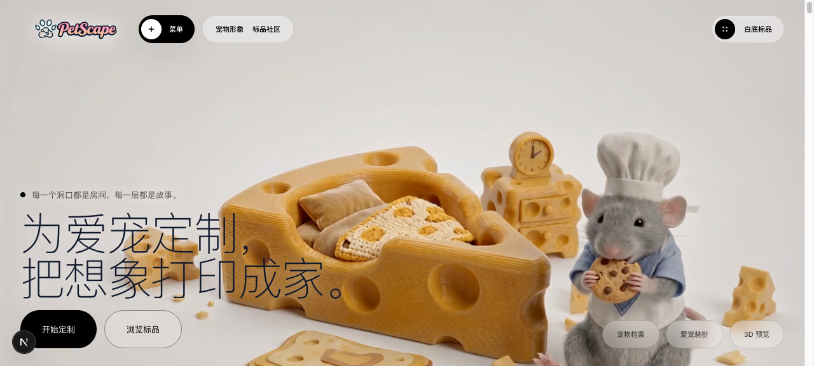
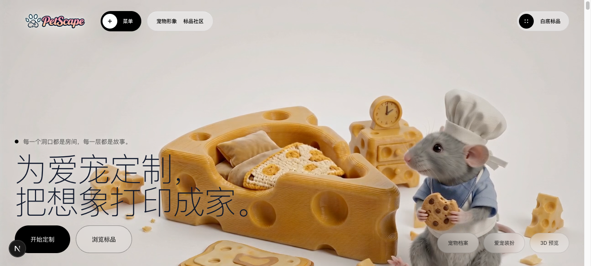
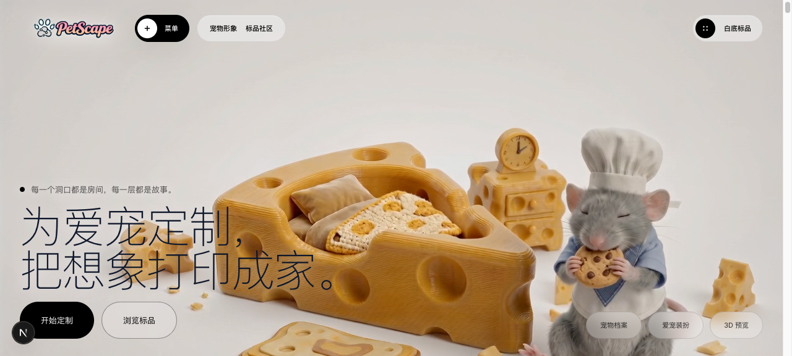
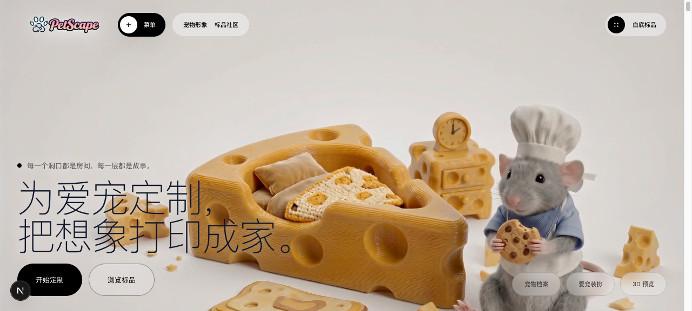

# Dogfood Report: PetScape STL Export

| Field | Value |
|-------|-------|
| **Date** | 2026-07-07 |
| **App URL** | http://localhost:3000/?mock=1 |
| **Session** | petscape-e2e / petscape-issue1 |
| **Scope** | End-to-end mock user flow: upload pet photo -> generate 3D avatar -> slicing/quote -> STL export in manufacturing and order flow |

## Summary

| Severity | Count |
|----------|-------|
| Critical | 0 |
| High | 1 |
| Medium | 0 |
| Low | 0 |
| **Total** | **1** |

## Result

The end-to-end flow does not currently pass from the UI as a real user path.

- Fresh mock page loaded correctly.
- Pet photo upload succeeded: preview appeared and the generate button became enabled.
- Clicking `生成 3D 可旋转预览` did not trigger any `/avatar` request.
- The page stayed in `等待生成 / 请先上传照片`, showed no error, and never reached STL export.
- Backend/API generation was tested separately with the same uploaded project and did produce `avatarSlice.stlUrl`.
- After backend state existed, the UI correctly showed two visible `下载 STL 模型` links and no visible G-code text.
- The STL URL returned HTTP 200 and downloaded a 5,185,884-byte `.stl` file.
- Mobile width 390px kept both STL links visible.

## Issues

### ISSUE-001: Generate button does nothing after pet photo upload

| Field | Value |
|-------|-------|
| **Severity** | high |
| **Category** | functional |
| **URL** | http://localhost:3000/?mock=1 |
| **Repro Video** | videos/issue-001-generate-click-noop.webm |

**Description**

After a user uploads a pet photo, the UI shows the uploaded preview and enables `生成 3D 可旋转预览`. Clicking the button does not start the generation pipeline: there is no loading state, no `/avatar` network request, no error message, and no eventual STL export. This blocks the real user path before the STL feature can be reached.

**Repro Steps**

1. Navigate to `http://localhost:3000/?mock=1`.
   

2. Upload a pet image through the pet creator upload control. The preview appears and the generate button is enabled.
   

3. Click `生成 3D 可旋转预览`.
   

4. **Observe:** the page remains in the waiting state and no `/avatar` request is captured. The visible HUD still says `请先上传照片`; no pipeline stage or STL download appears.
   

## Passing Checks

These checks were run after manually triggering the same uploaded project's backend mock generation API, to isolate the STL export UI from the blocked generate click.

| Check | Evidence |
|-------|----------|
| Backend mock generation reaches `avatarSlice.status=done` | `POST /api/project/{id}/avatar?mock=1` returned 202; polling showed `stlUrl` |
| Manufacturing section shows STL-only export | `screenshots/ab-06-api-generated-ui-ready.png`; DOM had one `.quote-download-btn` with `下载 STL 模型` |
| Order flow shows STL-only export | `screenshots/ab-06-api-generated-ui-ready.png`; DOM had one `.order-export-button` with `下载 STL 模型` |
| No visible G-code text after ready state | DOM check returned `gcodeVisible: false` |
| STL URL is downloadable | `curl -I` returned HTTP 200; downloaded `downloads/http-model.stl` was 5,185,884 bytes |
| Mobile layout keeps export CTAs visible | `screenshots/ab-07-mobile-ready.png`; both STL buttons visible at 390x844 |

## Verification Boundary

The browser-level file upload was performed through the page's hidden file input via automation. It triggered the same visible uploaded-preview state and upload API behavior a real file chooser should produce, but the OS file picker itself was not manually operated. The core failing step is after upload: clicking the visible enabled generate button produced no avatar request.
