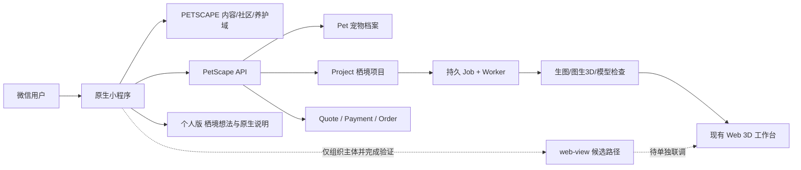

# PETSCAPE 宠境原生小程序整合说明

## 结论

公开 GitHub 仓库 `AlfredGuquan/petscape-ai` 当前只有 `main` 分支，文件树没有现成的微信小程序目录或 `project.config.json`。本次新增 `miniapp/` 作为原生微信小程序壳，直接复用仓库已有的业务 API、数据库模型、持久任务和 3D Web 工作台。

## 产品分工

| 层 | 小程序承担 | 现有 PetScape 承担 |
|---|---|---|
| 用户关系 | 首页、知识、社区、宠物档案、消息入口 | Better Auth 账户基础能力；小程序通过微信会话桥接到同一 User/Session 模型 |
| 设计入口 | 个人版保存栖境想法名称、展示项目列表 | AI 生图、三视图、图生 3D、模型检查、场景确认在既有 Web 链路 |
| 3D 预览 | 个人版显示原生说明及养护/档案入口；组织版候选路径单独验证 | Next.js Web 工作台、Three.js/模型查看器 |
| 交易 | 展示报价、订单和制作进度 | Quote、PaymentIntent、Order、Worker 状态机 |
| 内容服务 | 知识详情、发帖/评论/点赞、养护记录与提醒、同城筛选 | 内容域、审核运营台及匿名事件/错误汇总；本机真实数据库已验收，线上与微信联调待完成 |

## 关键数据流



## 鉴权决策

当前 PetScape API 使用 Better Auth 会话 Cookie；原生小程序改用 `wx.login` + 服务端 `code2Session` 换取 openid，再在 `Account(providerId=wechat-miniprogram)` 与 `Session` 表中创建/复用身份。小程序后续请求通过 `X-PetScape-Session` 发送 30 天票据，业务路由同时兼容 Web Cookie。AppSecret 只能放服务端环境变量。

## 当前边界

`miniapp/utils/request.js` 在本地预览默认走 mock 数据，并标注示例内容与服务；切换 `miniapp/utils/config.js` 的 `mockMode=false` 后，会在首次受保护请求前调用 `wx.login`。知识、社区、养护和服务目录已接入统一请求层，公开读取无需先登录；发布内容默认待审。接口合同、状态与限制见 [小程序内容规范](specs/miniapp-content.md)。正式环境仍需迁移数据库、完成微信登录和域名联调；微信支付与正式 3D web-view 不因本轮内容功能而自动开放。

## 本次联调所需环境变量

独立本机数据库的迁移、旧数据升级与真实集成测试已完成，入口见 [本机运行手册](runbooks/miniapp-local-postgres.md)，结果见 [数据库验收记录](operations/miniapp-database-2026-10-16.md)。这些结果不替代正式环境迁移或微信真机验收。

随后完成的 [实际 HTTP 验收](operations/miniapp-http-2026-10-16.md)通过数据库 Session fixture 驱动非 mock 请求层，未使用微信和 OSS 凭据。用户已确认尚未注册微信小程序账号，正式 AppID 暂不存在；先按 [账号准备指引](runbooks/miniapp-account-setup.md)注册，不能用公众号 AppID 或游客配置替代。

2026-10-16 用户选择个人主体。上文 `web-view` 的 3D 工作台整合是技术设计，不能作为个人版开放承诺：[微信官方文档](https://developers.weixin.qq.com/miniprogram/dev/component/web-view.html)明确个人类型暂不支持该组件。原生 3D 替代尚未实现；社区发帖/评论是否能开放仍需核对实际账号类目。

个人版入口调整和六类宠物表单修复见 [验收记录](operations/miniapp-personal-2026-10-16.md)。本机配置诊断入口为 `node scripts/check-miniapp-ready.mjs`，其报告不代替微信后台、真机或线上验收。

```text
WECHAT_MINIPROGRAM_APP_ID=微信小程序 AppID
WECHAT_MINIPROGRAM_APP_SECRET=微信小程序 AppSecret
```

AppSecret 只配置在部署环境的 Web 服务，不能写进 `miniapp/` 目录。微信公众平台还需要把 `https://petscape3d.com` 配置为 request 合法域名。

## 体验链接交付规则

每次代码更新后，交付消息必须同时说明：

1. 当前更新是否已经部署到正式线上地址。
2. 若 Web 预览已启动，提供对应的本地或临时公网 URL，并注明有效期。
3. 若更新内容是原生小程序，提供微信开发者工具导入路径 `miniapp/`；普通浏览器 URL 只能代表 Web 端，不能替代小程序真机体验。

本地 Web 预览默认地址为 `http://127.0.0.1:3100/?mock=1`。正式线上地址为 `https://petscape3d.com`，只有部署完成并完成 HTTP 验证后，才能称为本次更新的线上体验链接。
