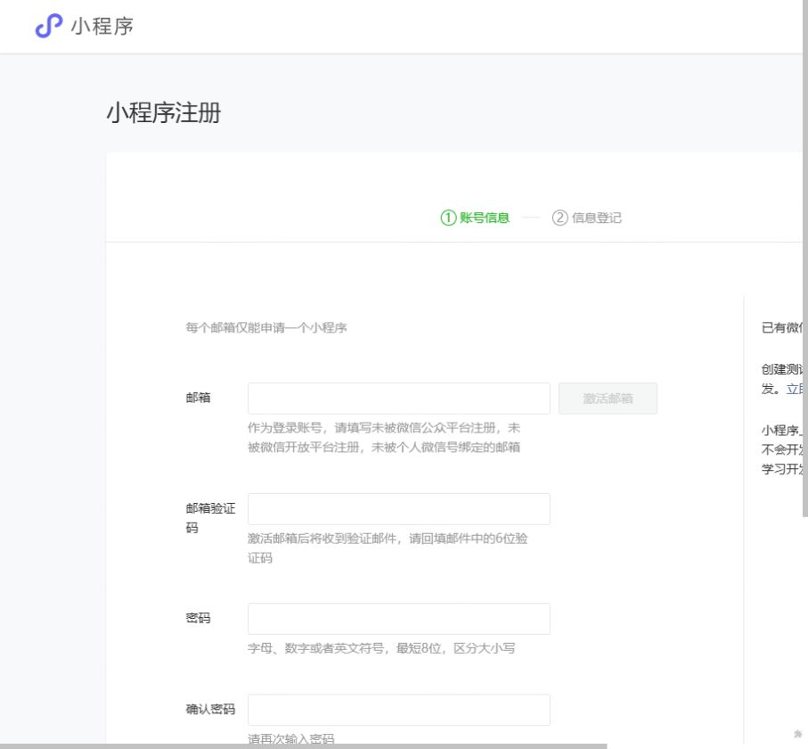

# PETSCAPE 微信小程序账号准备

当前用户已确认尚未注册小程序账号、没有营业执照，选择先以个人主体注册，所以暂时没有正式 AppID。AppID 可以理解为该小程序的身份证号；AppSecret 是服务端用的密码，两者用途不同。

## 用户本人完成

1. 打开 [官方小程序注册表](https://mp.weixin.qq.com/wxopen/waregister?action=step1&source=mpregister)，也可从 [微信公众平台](https://mp.weixin.qq.com/)依次点击“立即注册 → 小程序 → 前往注册”。
2. 本人填写可用邮箱、邮件验证码并设置密码。2026-10-16 实际注册页面说明邮箱须未被公众平台、开放平台注册且未绑定个人微信；每个邮箱仅申请一个小程序。密码、验证码及协议由本人处理。
3. 信息登记时按已选方案选择个人主体，按平台页面完成资料和本人微信验证。个人账号的可选类目、收费、认证和审核要求以办理时页面为准，不承诺全部社区或交易能力可用。
4. 注册后在小程序后台查找“AppID（小程序 ID）”，将这一项提供给开发者；不要发送 AppSecret、验证码或登录密码。

[腾讯云官方指引](https://intl.cloud.tencent.com/document/product/1254/73282?lang=en)在“Obtain the developer ID”中说明登录小程序后台查看 AppID 的方式。其后续 AI 应用绑定步骤与本项目无关，不照搬。

官方注册表截图（未填写个人资料）：

## 个人主体对当前方案的影响

2026-10-16 直接核对 [微信官方 web-view 文档](https://developers.weixin.qq.com/miniprogram/dev/component/web-view.html)：个人类型小程序暂不支持 web-view。因此，现有“内嵌官网 3D 工作台”方案不能作为个人版的上线承诺；后续若需要小程序内 3D，应另行评估原生渲染方案，不能将普通网页链接冒充小程序能力。

宠物档案、养护和站内提醒继续进行现有技术联调；社区发布/评论和服务内容是否可面向用户开放，须对照个人账号后台实际可选类目与审核结果。当前仍是游客 mock 预览，尚未提交个人版审核；本次没有修改成伪装类目或隐藏功能的提审包。

## 开发侧继续完成

- 将正式 AppID 配入 `miniapp/project.config.json`；当前继续保留 `touristappid` 和默认 mock，避免把未接通状态当真实体验。
- AppSecret 仅由本人配置在本机项目根 `.env` 或部署平台密钥设置，客户端与 Git 不保存它。
- 登录微信开发者工具并核对该账号开发权限；再进行真实微信登录、域名配置、真机验收、上传及体验成员设置。
- 每轮交付区分本地、GitHub、后端和小程序版本；成功上传并验证后才提供最新微信体验二维码。

已完成的本机数据库和 HTTP 验收见 [运行手册](miniapp-local-postgres.md)与 [HTTP 记录](../operations/miniapp-http-2026-10-16.md)。目前没有可供手机扫码进入的 PETSCAPE 微信体验版。
