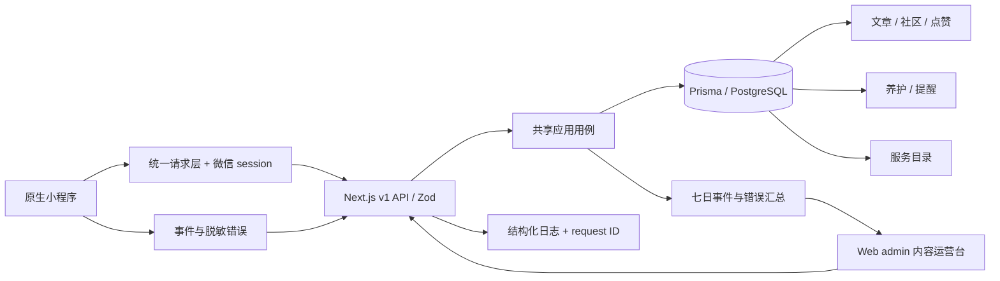

# PETSCAPE 原生小程序 P1/P2 内容域

状态：本地代码、真实 PostgreSQL 与实际 HTTP 验收完成；真实微信登录、真机、生产部署待验收。HTTP 使用数据库会话 fixture，不代表微信认证通过。范围来自用户确认的原生小程序内容/社区迭代，与根 `PRODUCT-MODULES.md` 中的 3D/交易 P1/P2 分开管理。

## 产品闭环

| 能力 | 用户行为与完成标准 |
|---|---|
| 养护知识 | 在社区的官方帖分区按物种或空间设计筛选，打开正文，星标后可从当前设备的“已收藏”查看；下架内容不显示 |
| 社区 | 按主题浏览，提交帖子或评论后进入待审；运营通过后公开；作者在「我的投稿」刷新帖子状态并展开正文；点赞和取消点赞重试保持同一结果 |
| 养护 | 选择自己的宠物，新增喂食、饮水、清洁、体重、观察记录；保存后仍停留在选中的宠物 |
| 提醒 | 为自己的宠物设置标题和到期时间，进入养护页查看到期状态并标记完成；重复完成保留首次时间 |
| 同城服务 | 按城市和服务类型筛选已发布服务商，复制公开联系方式；首版不承诺预约、支付或履约 |
| 运营 | admin 新增知识草稿、待审服务商，查看帖子/评论并发布、拒绝或下架；普通账号不能使用 |
| 观测 | 汇总近七日事件和客户端错误，服务端异常保留日志，HTTP 响应附带 `x-request-id` |

官网分类为花枝鼠、守宫、蛇类、鹦鹉、蜘蛛，并保留其他异宠。图卡使用仓库官网素材的压缩副本；页面沿用 PETSCAPE 品牌。

宠物档案移除小程序体型等级输入，生命阶段支持幼年、亚成体、成体、老年及待确认；按具体物种核实年月，未有完整依据时明确待核实。范围和来源见 [档案生命阶段规范](miniapp-life-stages.md)。

养护历史从首页或单宠详情进入时预选指定宠物，默认先看记录。新增记录可选择过去的日期和时间，省略时按当前时间保存。每条记录可纠正数值、备注和时间，也可经确认删除。未提交的记录与提醒草稿按宠物在当前页面暂存。保存、删除和提醒操作期间锁定切换与其他写入，直到刷新结束。读取失败清空旧列表，重试成功后恢复操作。服务筛选只接受最新一次请求的成功或失败结果。

## 首页增量（2026-11-16）

用户确认白底黑字、少量品牌粉色；本轮仅改首页，保留品牌区与知识内容。存在宠物档案时，以体重记录替换“现在开始”；后续确认以圆形宠物滑块替代黑色养护主卡与横排头像，中间头像放大、两侧缩小渐隐。左右滑动按宠物 ID 切换，切换后同步体重和养护记录。点击任意圆形头像进入对应编辑档案。头像下方显示圆形「＋ 添加设备」，点击可查看设备配对状态。当前按用户确认的未连接状态验收。无宠物时保留黑色养护引导与原有建档入口。后续界面替换须逐轮确认。

首页优先展示已有 coverUrl，图片失效时回退物种图，再回退 emoji。本轮不加入头像上传入口，也不改其他页面、后端鉴权、API 或数据库。自定义上传与整套线稿仍是后续目标，须另行确认具体实现。

体重与喂食一行两列。喂食卡显示所选宠物最近的喂食记录。体重沿用现有养护记录，以“体重”类型保存。点击「记体重」打开弹窗，支持 g/kg、最多三位小数，正数不超过 1000 kg，换算成 g 后提交。历史只识别带 g/kg/克/千克/公斤的有效正数，不猜测无单位旧文本；按测量时间排序，显示最近七次、最近值和与上次之差，支持在同一组数据的柱状图和折线图间切换。

现有接口最多返回最近 100 条混合养护记录，因此首页注明提取范围；没有可解析记录时显示“近期暂无可显示的体重”，不承诺完整历史或从未记录。草稿按宠物分开保留在页面内，保存至刷新结束期间以静态当前头像替代滑块，禁止切宠、档案跳转和再次提交；写入已成功但刷新失败时仍明确“已保存”。保存结果不明时保留输入并要求先刷新核对，不自动重放。行为证据见 [首页验收记录](../operations/miniapp-home-2026-11-16.md)。

体重与喂食卡下方提供喂食、换水、清洁、生病四块快捷按钮。按钮打开固定宠物的确认弹窗，症状记录须填写观察内容，再由用户确认保存。历史与提醒仍可由快捷区下方的文字入口查看。

## 首页记录与社区增量（2026-11-24）

喂食弹窗单独记录可选克数，允许大于 0 的数值和最多三位小数。已有养护接口的 `value` 保存明确的 g 值，食物和份数随备注保存；不填写克数时仍可记录文字。首页两个图表分别展示最近七次有单位的同类测量，数据来自当前宠物最近 100 条养护记录。旧的食物名称和份数保留在养护历史中。

底栏改为首页／宠物／社区／我的。已发布文章复用原内容接口显示为官方帖，原知识入口转到社区。星标保存在当前设备，演示与实际收藏分开；已收藏重新查询文章可见性。线上公开文章接口于 2026-11-24 返回空列表，示例素材仅用于开发验收。运营台发布养护文章后，社区从同一接口读取。

### 图文投稿与成长照片分享

社区「＋ 发帖」可先选图，也可填写文字或继续草稿。每篇最多九张照片，首图为封面，可调整顺序和移除。需填写标题，正文至少有文字或照片之一。编辑内容按账号保存在当前设备，一次保留一份草稿。成长记录的「分享到社区」只带入所选照片，由主人确认提交；草稿恢复时重新获取私有图片地址。

相册选图通过独立的投稿图片入口上传到私有对象存储。投稿创建时验证图片资产归属，并记录顺序。来自成长记录的照片还需关联有效的本人档案。待审核图片仅投稿人和运营人员可读，公开列表只显示已发布的封面，帖子详情按顺序显示所有图片。社区图片由帖子路径提供，下架后该路径停止公开读取。提交结果不明时沿用原投稿标识和图片顺序重试。上线顺序为数据库迁移、独立 API 与上传代理、微信端。

### 喂食流程对照

本轮对照用户提供的两张竞品截图。月历区分待喂与已喂，设置页在保存前显示选中的宠物、间隔、比例和当前体重。25 g 与 26.2 g 两个示例在同样 18% 下分别显示 4.5 g 与 4.7 g。截图中的比例是可见设置值，物种适用性、默认值和批量设置效果仍待核实。

PETSCAPE 当前分开保存实际喂食与单次站内提醒。首页喂食卡标出有克数记录的时间，较新的文字记录另行显示。体重和喂食折线按真实时间间隔定位，同一时刻的测量不虚构间隔，柱状图仍按记录顺序排列。单日只显示一个日期，跨年显示完整日期。

审阅分支从首页当前宠物的喂食卡进入独立月历。计划按宠物保存在当前设备，可设开始日与重复间隔，食量可留空、输入固定克数，或按饲主输入的比例与最近一次明确体重计算。比例区显示体重和称重时间。月历分别标记从今天起的计划日期，以及最近 100 条养护记录包含的实际喂食日期。过去日期补记带入当前宠物和日期，需要选择实际记录时间。原日期保存成功后返回月历刷新。

审阅版沿用 PETSCAPE 黑白与品牌粉色。用户可自行设置周期与食量，页面无通用默认值。计划保存在当前设备，实际喂食继续复用服务端养护记录。跨设备计划、推送、批量设置和导出等待单独确认。

## 单宠成长记录数据增量（2026-11-24）

`PetGrowthEntry` 按 owner 与 pet 关联，支持文字、记录时间和软删除。`PetGrowthEntryPhoto` 按顺序关联已有 Asset，一条记录最多六张照片，同一 Asset 只能用于一条成长记录。照片使用独立 `growth_photo` kind，经现有签名上传、确认、魔数校验和短时私有下载流程，不复用 `coverAssetId`。含私有记录和签名照片地址的响应设置 `Cache-Control: private, no-store`。

新增 `GET/POST /api/v1/pets/:id/growth-entries`、`PATCH/DELETE /api/v1/pets/:id/growth-entries/:entryId` 和 `POST /api/v1/pets/:id/growth-entries/photos`。接口以当前 session 验证本人和有效宠物，列表按时间倒序分页，创建支持纯文字或照片。创建可携带 `saveKey` 和固定的记录时间，原请求重试返回同一条记录，改动已提交内容返回冲突。

单宠详情的「最近养护」下方显示分页成长时间线。用户可打开写记录页，选日期、填文字、从相册或相机选照片，保存后返回查看。照片保持原始比例，缩略图可点开原图。上传失败保留草稿和已确认的照片资产，提交结果未确认时沿用原请求重试。

## 接口分工

具体字段以 [Zod contract](../../packages/server/src/contracts/community-content.ts) 为准。

| 接口 | 权限与用途 |
|---|---|
| `GET /api/v1/content/articles`、`GET /api/v1/content/articles/:id` | 公开已发布知识 |
| `GET/POST /api/v1/community/posts` | 公开列表 / 登录后提交待审帖子 |
| `GET /api/v1/community/posts/mine` | 登录；分页读取当前会话本人投稿及待审核、已发布、未通过、已下架状态；私有响应禁用缓存 |
| `GET /api/v1/community/posts/:id` | 公开已发布帖子详情 |
| `GET/POST /api/v1/community/posts/:id/comments` | 公开已发布评论 / 登录后提交待审评论；父帖须已发布 |
| `POST /api/v1/community/posts/:id/like` | 登录；显式提交 `liked`，唯一约束避免重复点赞 |
| `GET/POST /api/v1/care-logs` | 登录；仅本人宠物的记录 |
| `PATCH/DELETE /api/v1/care-logs/:id` | 登录；修改、删除本人有效宠物的养护记录 |
| `GET/POST /api/v1/care-reminders`、`PATCH /api/v1/care-reminders/:id` | 登录；本人提醒列表、新建、完成 |
| `GET /api/v1/service-providers` | 公开已发布目录；城市/服务类型过滤 |
| `POST /api/v1/analytics/events` | 固定事件和属性白名单；不接收正文、手机号、token 或任意错误堆栈 |
| `GET/POST /api/v1/admin/content` | admin；审核队列 / 新增文章与服务商 |
| `POST /api/v1/admin/content/moderate` | admin；审核状态更改 |
| `GET /api/v1/admin/content/analytics` | admin；近七日事件数量与最近错误 |

文章允许草稿、发布、归档；帖子/评论/服务商允许待审、发布、拒绝、归档。请求不能自行指定内容发布状态。数据库 check constraint 与应用校验同时限制状态。

## 可评审架构

继续使用同一模块化单体、User/Session 和数据库，不增加独立内容服务。提醒是持久化的站内到期事项；微信订阅消息的授权、模板与投递尚未实现。监控首版包含错误收集与运营查询，外部告警投递尚未接入。

## 交付与验收边界

- mock 仅用于界面与交互体验；示例服务商不代表实际入驻；待审内容在 mock 中也不公开。
- 新 migration 从上一个 schema 经 `prisma migrate diff --script` 生成，附加状态约束。尚未对生产数据库执行。
- Node 24 运行无数据库用例与原生交互回归；CI 的 PostgreSQL job 执行真实所有权、审核、并发点赞和提醒测试。缺数据库时本地明确 skip，CI 不允许静默 skip。
- Windows 独立 PostgreSQL 的迁移、旧数据升级和真实集成测试使用 [本机运行手册](../runbooks/miniapp-local-postgres.md)；本轮已完成的本机行为证据见 [数据库验收记录](../operations/miniapp-database-2026-10-16.md)，线上与真机分别验收。
- 实际 HTTP 与非 mock 请求层的验收见 [HTTP 记录](../operations/miniapp-http-2026-10-16.md)；该范围覆盖无 OSS 的数据库功能，不包含图片上传、微信 code2Session 或设备渲染。
- 个人版入口与六类宠物表单见 [后续验收](../operations/miniapp-personal-2026-10-16.md)；个人主体不承诺内嵌 3D 网页，其他异宠必须填写具体物种，清空选填资料按合同发送 null。
- 多宠物切换、草稿隔离、读写锁定及服务筛选竞态见 [养护与筛选验收](../operations/miniapp-care-2026-10-16.md)。
- 官方 WXML/WXSS 编译不等同于开发者工具模拟器、真机截图或上线验收；后续还需真实微信登录、接口域名和机型测试。
- 正式体验码需要有效 AppID、开发者工具登录及上传权限；当前游客配置无法提供微信真机体验链接。
