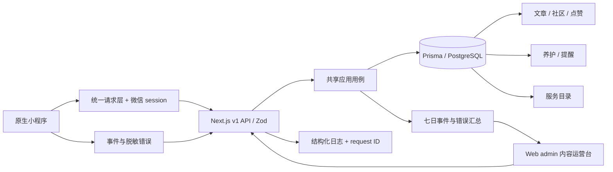

# PETSCAPE 原生小程序 P1/P2 内容域

状态：本地代码与静态/单元验证完成；真实数据库、微信真机、生产部署待验收。范围来自用户确认的原生小程序内容/社区迭代，与根 `PRODUCT-MODULES.md` 中的 3D/交易 P1/P2 分开管理。

## 产品闭环

| 能力 | 用户行为与完成标准 |
|---|---|
| 养护知识 | 按官网物种分类或空间设计筛选，打开正文；下架内容返回不存在 |
| 社区 | 按主题浏览，提交帖子或评论后进入待审；运营通过后公开；点赞和取消点赞重试保持同一结果 |
| 养护 | 选择自己的宠物，新增喂食、饮水、清洁、体重、观察记录；保存后仍停留在选中的宠物 |
| 提醒 | 为自己的宠物设置标题和到期时间，进入养护页查看到期状态并标记完成；重复完成保留首次时间 |
| 同城服务 | 按城市和服务类型筛选已发布服务商，复制公开联系方式；首版不承诺预约、支付或履约 |
| 运营 | admin 新增知识草稿、待审服务商，查看帖子/评论并发布、拒绝或下架；普通账号不能使用 |
| 观测 | 汇总近七日事件和客户端错误，服务端异常保留日志，HTTP 响应附带 `x-request-id` |

官网分类为花枝鼠、守宫、蛇类、鹦鹉、蜘蛛，并保留其他异宠。图卡使用仓库官网素材的压缩副本；页面沿用 PETSCAPE 品牌。

## 接口分工

具体字段以 [Zod contract](../../packages/server/src/contracts/community-content.ts) 为准。

| 接口 | 权限与用途 |
|---|---|
| `GET /api/v1/content/articles`、`GET /api/v1/content/articles/:id` | 公开已发布知识 |
| `GET/POST /api/v1/community/posts` | 公开列表 / 登录后提交待审帖子 |
| `GET /api/v1/community/posts/:id` | 公开已发布帖子详情 |
| `GET/POST /api/v1/community/posts/:id/comments` | 公开已发布评论 / 登录后提交待审评论；父帖须已发布 |
| `POST /api/v1/community/posts/:id/like` | 登录；显式提交 `liked`，唯一约束避免重复点赞 |
| `GET/POST /api/v1/care-logs` | 登录；仅本人宠物的记录 |
| `GET/POST /api/v1/care-reminders`、`PATCH /api/v1/care-reminders/:id` | 登录；本人提醒列表、新建、完成 |
| `GET /api/v1/service-providers` | 公开已发布目录；城市/服务类型过滤 |
| `POST /api/v1/analytics/events` | 固定事件和属性白名单；不接收正文、手机号、token 或任意错误堆栈 |
| `GET/POST /api/v1/admin/content` | admin；审核队列 / 新增文章与服务商 |
| `POST /api/v1/admin/content/moderate` | admin；审核状态更改 |
| `GET /api/v1/admin/content/analytics` | admin；近七日事件数量与最近错误 |

文章允许草稿、发布、归档；帖子/评论/服务商允许待审、发布、拒绝、归档。请求不能自行指定内容发布状态。数据库 check constraint 与应用校验同时限制状态。

## 可评审架构

继续使用同一模块化单体、User/Session 和数据库，不增加独立内容服务。提醒是持久化的站内到期事项；微信订阅消息的授权、模板与投递尚未实现。监控首版包含错误收集与运营查询，外部告警投递尚未接入。

## 交付与验收边界

- mock 仅用于界面与交互体验；示例服务商不代表实际入驻；待审内容在 mock 中也不公开。
- 新 migration 从上一个 schema 经 `prisma migrate diff --script` 生成，附加状态约束。尚未对生产数据库执行。
- Node 24 运行无数据库用例与原生交互回归；CI 的 PostgreSQL job 执行真实所有权、审核、并发点赞和提醒测试。缺数据库时本地明确 skip，CI 不允许静默 skip。
- 官方 WXML/WXSS 编译不等同于开发者工具模拟器、真机截图或上线验收；后续还需真实微信登录、接口域名和机型测试。
- 正式体验码需要有效 AppID、开发者工具登录及上传权限；当前游客配置无法提供微信真机体验链接。
